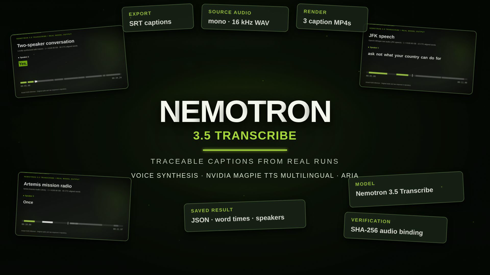

# Repo-to-video-nv-magpie

Turn a Git repository into a narrated MP4. Claude drafts a sourced storyboard, NVIDIA Magpie TTS Multilingual makes the voice, and Remotion renders the video.

## Example

[](examples/nemotron-transcribe-pilot/pilot.mp4)

[Watch the 62-second pilot](examples/nemotron-transcribe-pilot/pilot.mp4) · [Source repo: Nemotron 3.5 Transcribe](https://github.com/darren236/nemotron-transcribe-h100-demos) · [Shot map](examples/nemotron-transcribe-pilot/shot-map.md)

The film uses real demo output, four [video-shotcraft](https://github.com/Vincentwei1021/video-shotcraft) shots, and a visible Magpie voice credit. Its source is [editable in Remotion](video/src/shotcraft-production.tsx).

## Try it

Requires Python 3.10+, Git, Node.js, an authenticated Claude CLI, and `NVIDIA_API_KEY` ([get access](https://build.nvidia.com/nvidia/magpie-tts-multilingual/api)).

```bash
cd video && npm ci && cd ..
python3 repo_video.py prepare https://github.com/owner/repo --out projects/demo
# Review projects/demo/storyboard.json
python3 repo_video.py render projects/demo
```

Output: `projects/demo/video.mp4`. See [usage and templates](docs/usage.md), the [video-creator skill](skills/video-creator/SKILL.md), and [third-party notices](THIRD_PARTY_NOTICES.md).
