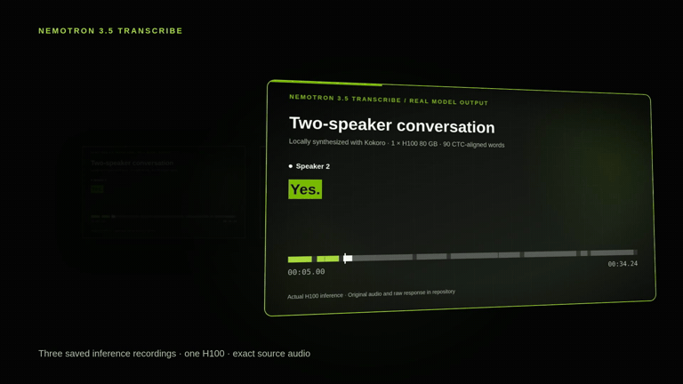
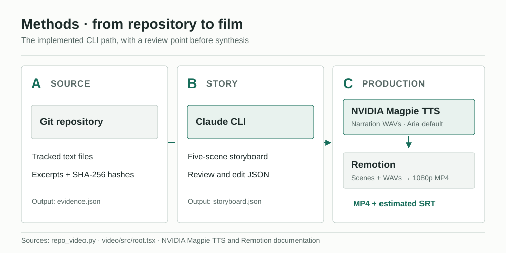
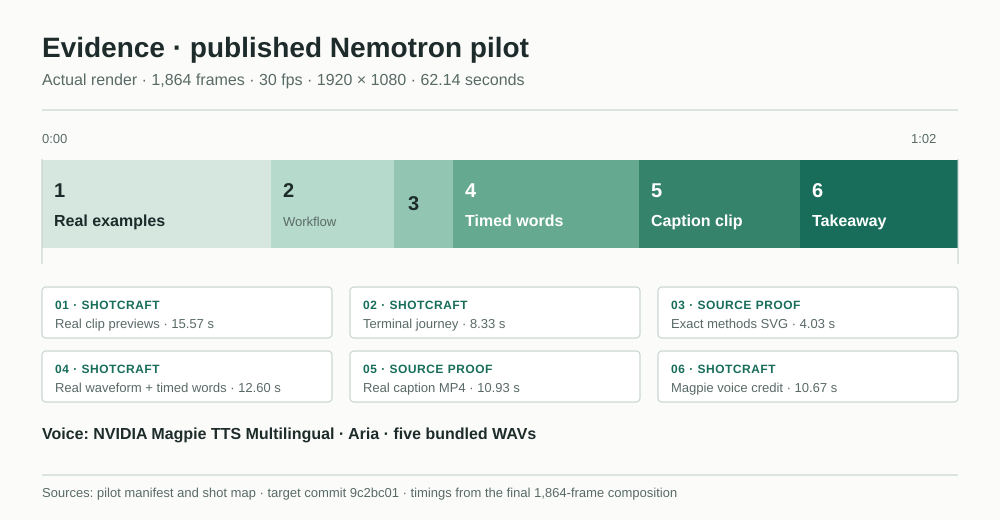
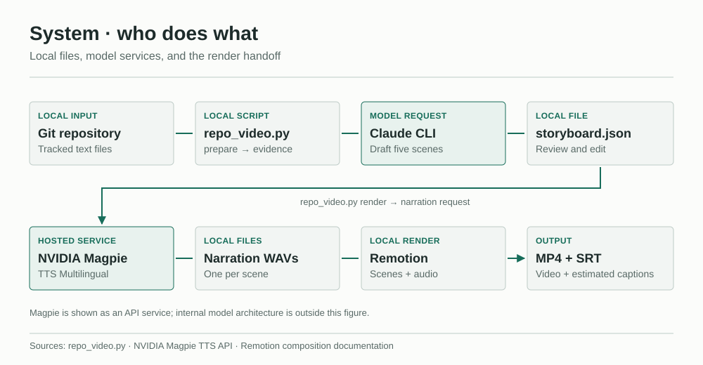

# Repo-to-video-nv-magpie

Turn a Git repository into a narrated MP4. **NVIDIA Magpie TTS Multilingual (Aria) synthesizes the voice**; Claude drafts a sourced storyboard and Remotion renders the video.

[](LICENSE)

[**Watch sample video**](https://darren236.github.io/Repo-to-video-nv-magpie/) · [**Hear Magpie narration**](https://darren236.github.io/Repo-to-video-nv-magpie/#magpie-voice) · [**User guide**](#user-guide)

## Example: Nemotron repository → video

**Input repository:** [darren236/nemotron-transcribe-h100-demos](https://github.com/darren236/nemotron-transcribe-h100-demos). **Output:** the 62-second film below, made with this project's tailored Shotcraft production route and NVIDIA Magpie narration.

[](https://darren236.github.io/Repo-to-video-nv-magpie/)

The film uses real saved output from that input repository and four adapted [video-shotcraft](https://github.com/Vincentwei1021/video-shotcraft) shots. The GIF preview is silent; [play the full video](https://darren236.github.io/Repo-to-video-nv-magpie/) to hear the voice. [Shot map](examples/nemotron-transcribe-pilot/shot-map.md)

### NVIDIA Magpie narration

[Listen to a 15-second Aria clip](https://darren236.github.io/Repo-to-video-nv-magpie/#magpie-voice) from the published film. Magpie synthesized five narration WAVs from the reviewed script; Remotion places them on the video timeline. Nemotron is the transcription model demonstrated in the film. [Voice ID and audio hashes](examples/nemotron-transcribe-pilot/manifest.json) · [Synthesis code](repo_video.py)

## User Guide

The CLI gathers source excerpts, asks Claude for an editable storyboard, sends narration text to NVIDIA Magpie TTS Multilingual, and renders scenes with Remotion. The [sample video](https://darren236.github.io/Repo-to-video-nv-magpie/) applies the more tailored Shotcraft production route to the separate Nemotron repository.

### How it works



**Methods.** `prepare` selects tracked text, records SHA-256 hashes, and drafts five scenes. Review the source evidence and storyboard before `render`. The renderer synthesizes one WAV per scene, then creates the MP4 and estimated SRT captions. [Implementation](repo_video.py).



**Published example.** The 62.14-second sample has six visual shots: four adapted [video-shotcraft](https://github.com/Vincentwei1021/video-shotcraft) cards and two source proof shots. It includes saved inference results, the target repository's own methods SVG, a real caption clip, and five Magpie narration WAVs. The final shot credits NVIDIA Magpie TTS Multilingual. See the [shot map](examples/nemotron-transcribe-pilot/shot-map.md) and [manifest](examples/nemotron-transcribe-pilot/manifest.json) for exact source commits and hashes.



**System boundary.** The repository, evidence, storyboard, WAVs, and Remotion render live in this project. Claude CLI drafts the story; NVIDIA Magpie TTS Multilingual synthesizes the voice. The Magpie box represents the hosted service, without claiming anything about its internal architecture.

### Set up

You need Python 3.10+, Git, Node.js with npm, an authenticated [Claude Code CLI](https://code.claude.com/docs/en/setup), and access to [NVIDIA Magpie TTS Multilingual](https://build.nvidia.com/nvidia/magpie-tts-multilingual/api). Install the pinned Remotion dependencies from the repository root:

```bash
cd video
npm ci
cd ..
```

Remotion 4.0.539 may warn that Zod differs from its own pin. This lockfile uses patched Zod 4.6.7 for [GHSA-mrhx-c7xc-m3w5](https://github.com/advisories/GHSA-mrhx-c7xc-m3w5); a clean install, typecheck, and full-timeline test render passed with the override.

Set `NVIDIA_API_KEY` in your environment or in a local `.env` file at the repository root. The `.env` file and generated `projects/` directory are ignored by Git. Do not commit your key.

### Make a video

Use a local Git repository or a plain public GitHub repository URL. `prepare` requires a **new** output directory:

```bash
python3 repo_video.py prepare /path/to/source-repo --out projects/demo
# Or: python3 repo_video.py prepare https://github.com/owner/repo --out projects/demo
```

Read `projects/demo/evidence.json` for the selected file excerpts and hashes. Edit `projects/demo/storyboard.json` for factual accuracy, pacing, pronunciation, and scene visuals. Each scene cites paths in the evidence file. The CLI validates the scene count and narration length when it prepares and renders.

Render with the default Remotion style and Aria voice:

```bash
python3 repo_video.py render projects/demo
```

The result is `projects/demo/video.mp4`. The directory also contains `audio/scene-*.wav`, `captions.srt`, `render-props.json`, and `manifest.json`. Captions use sentence-length estimates; review their timing before publishing. The manifest records the source commit, selected file hashes, voice, template, duration, and MP4 hash. A rendered project cannot be rendered again with the same `render` command; make a new output directory for another source run.

### Choose a visual route

| Route | Use it for | Command or source |
| --- | --- | --- |
| `standard` | A quick, editable five-scene explainer | `python3 repo_video.py render projects/demo` |
| `shotcraft-ink` | The same script with a paper-and-ink Remotion treatment inspired by Shotcraft motion | `python3 repo_video.py render projects/demo --template shotcraft-ink` |
| Shotcraft production | A custom film that adapts actual Shotcraft template or shot implementations to real repo media | [Video-creator skill](skills/video-creator/SKILL.md) and [sample source](video/src/shotcraft-production.tsx) |

The CLI templates are its own Remotion implementations. For the third route, inspect the pinned Shotcraft references, select fitting shots, adapt their actual motion and source code, and record the mapping. The sample follows that route; its [shot map](examples/nemotron-transcribe-pilot/shot-map.md) distinguishes adapted cards from plain Remotion proof shots.

To change only the CLI video's visual style, reuse the saved narration without another Magpie request:

```bash
python3 repo_video.py rerender projects/demo --template shotcraft-ink
```

This writes `video-shotcraft-ink.mp4` and its manifest beside the original output. For a different narrator, use `--voice` with `render` on a new project; the default is `Magpie-Multilingual.EN-US.Aria`. Check available voices in the [NVIDIA API reference](https://build.nvidia.com/nvidia/magpie-tts-multilingual/api).

### Inspect or rebuild the bundled sample

[Watch sample video](https://darren236.github.io/Repo-to-video-nv-magpie/), view its [GIF preview](examples/nemotron-transcribe-pilot/preview.gif) or [poster](examples/nemotron-transcribe-pilot/poster.png), or inspect the [contact sheet](examples/nemotron-transcribe-pilot/contact-sheet.png). The [manifest](examples/nemotron-transcribe-pilot/manifest.json) identifies the target source commit, Shotcraft revision, Magpie voice, and hashes for the bundled media. The original storyboard and Magpie WAVs were created from an earlier source commit; the [shot map](examples/nemotron-transcribe-pilot/shot-map.md) explains the later source refresh.

From `video/`, rebuild the editable Remotion composition with the bundled WAVs and media. This render does not request new speech:

```bash
mkdir -p ../projects/nemotron-transcribe-pilot
npx remotion render src/index.ts ShotcraftPilot ../projects/nemotron-transcribe-pilot/pilot.mp4
```

### Source and sharing

`prepare` skips common secret paths, binary assets, and lines resembling credentials, but the filters are not a guarantee. Inspect `evidence.json` before processing a confidential repository: selected excerpts go to Claude, and narration text goes to NVIDIA. The input repository is not modified. The CLI does not capture a running UI or publish the result. Verify claims, media rights, audio, and caption timing before sharing.

Original code and documentation use the [MIT License](LICENSE). The bundled video, narration, source demo media, and Shotcraft-derived code have separate terms; see [third-party and media notices](THIRD_PARTY_NOTICES.md).
